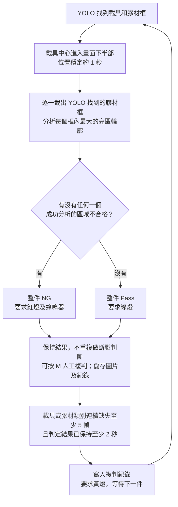

# 斷膠檢測：簡化流程與四個區域的處理

依據 V6.0.7 原始行為；目前設定檔為 [`config/config.ini`](../config/config.ini)。目前已拆分為 [cutsealant 模組](../cutsealant/)，原始主程式保留為相容啟動入口；以下流程不變。以下燈號表示程式要求的燈號，不代表已確認硬體實際執行成功。

## 簡化流程

啟動時要求黃燈。尚未滿足檢測條件時，首次檢測前維持黃燈。約 1 秒是用累計處理幀數除以設定 FPS 估計，並非精確計時。

## 燈號與 Pass 條件

| 情況 | 程式結果 / 要求燈號 |
| --- | --- |
| 啟動、待機、等待首次檢測條件成立 | 黃燈 |
| 成功分析的區域沒有任何一個不合格 | Pass / 綠燈 |
| 至少一個成功分析的區域不合格 | NG / 紅燈，並另外發出蜂鳴器命令 |
| 已判定，載具和膠材仍在畫面 | 維持原結果及燈號，不重複做斷膠分析 |
| 載具或膠材類別連續缺失達到容忍幀數，且最短保持時間已過 | 回到待機 / 黃燈 |

YOLO 負責找「載具」和「膠材」的位置；斷膠結果來自後續 OpenCV 影像分析。YOLO 仍持續尋找物件，但每輪載具只觸發一次斷膠品質分析。

人工複判會改變 CSV 中的最終結果，不會重新切換三色燈，也不會改寫原本的檢測統計。

## 四個區域如何處理

程式沒有固定的四區座標、沒有把一個大 ROI 自動切成四塊，也沒有要求一定要找到四個膠材框。它按 YOLO 回傳的框逐個處理。

| YOLO 回傳的內容 | 程式實際處理方式 |
| --- | --- |
| 四個獨立膠材框 | 裁出四張小圖，各分析一次；任一結果 NG，整件 NG |
| 只有三個膠材框 | 只分析三個；若三個都通過，整件仍可能 Pass，未檢查第四個是否漏檢 |
| 一個大膠材框，內含四塊膠 | 只分析這張裁圖中最大的亮區輪廓，不會分別檢查四塊膠 |
| 有載具，但一個膠材框都沒有 | 無法滿足兩種類別都出現的條件，不觸發新檢測；持續缺失後回到或保持待機 |
| 某框裁圖為空、找不到輪廓或分析發生異常 | 跳過該框，不自動列為 NG；若其餘結果沒有失敗，仍可能 Pass |

每個框內的處理：

1. 取出亮度影像。
2. 用 K-means 分為三類，選最亮的一類。
3. 找外輪廓，只保留面積最大的一個。
4. 簡化輪廓後，使用 `cv2.isContourConvex()` 檢查是否為凸形；通過視為正常，不通過視為 NG。

函式雖然叫 `_loop_closed_identify`，實際檢查的是輪廓凸性，並沒有直接測量斷口寬度、膠材連續長度或逐一檢查四個位置。因此目前 Pass 的準確含義是「參與分析的輪廓沒有任何一個失敗」，不是「四個指定位置都已經檢查且正常」。

此外，YOLO 對整張畫面推論；膠材框沒有再檢查是否落在選中的載具框內。多載具或畫面有其他膠材時，可能混入其他位置的框。S1、S2 等編號來自檢測框順序，並未固定為左上、右上、左下、右下。

目前目錄缺少模型檔案，無法僅由這份 Python 確定模型實際會輸出「四個獨立膠材框」還是「一個包含四塊膠的大框」。

若生產規則要求四個固定位置，後續應明確定義四個位置的對應關係；必須四處都有有效檢測且全部通過，才給整件 Pass。此文件描述現況，未變更判定程式。

## 對照程式碼

- [YOLO 推論：`_yolo_detect`](../cutsealant/detector.py)
- [觸發條件及整體結果：`_check_detection_trigger`](../cutsealant/workflow.py)
- [逐框分析及彙總：`_cut_sealant_detection`](../cutsealant/inspection.py)
- [實際凸性檢查：`_loop_closed_identify`](../cutsealant/inspection.py)
- [收集膠材框：`_draw_detections`](../cutsealant/display.py)
