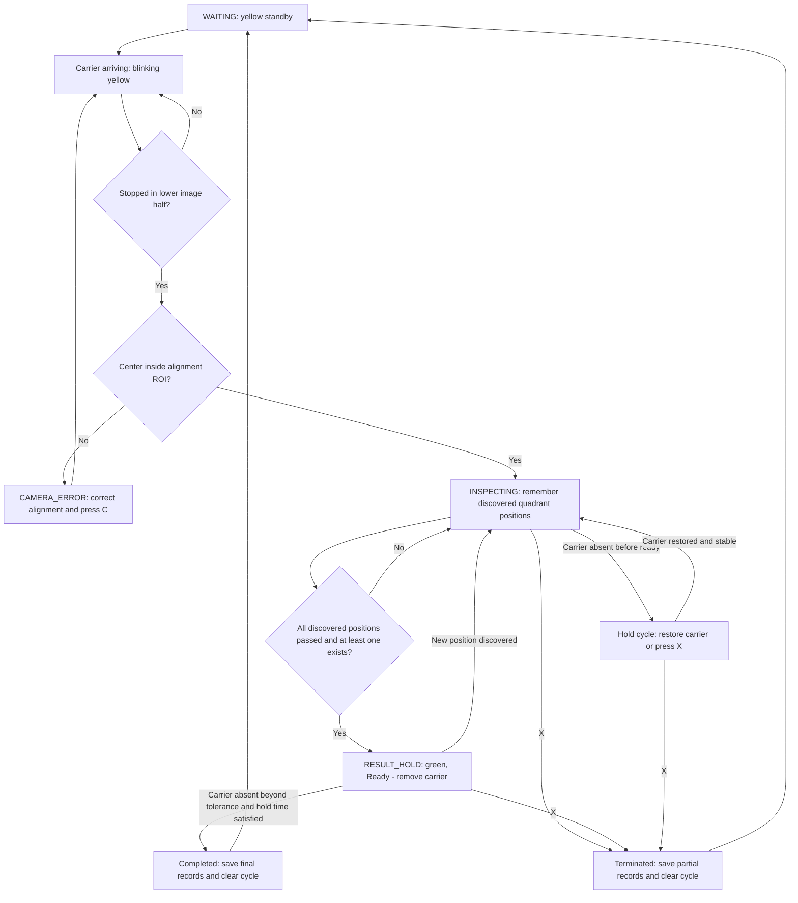

# Current CutSealant workflow

The historical filename is retained for existing links. `main.py` and the compatibility launcher now use the position-based services in `cutsealant/`; this document describes the active implementation.

## Carrier cycle

Carrier position must remain stable before judging unfinished cases. Stability uses processed-frame count divided by configured FPS; motion and loss reset unfinished streaks and require a fresh stability period. Carrier absence never depends on visible case count. Early departure cannot automatically create another cycle. X can restart the same carrier after stabilization, but does not clear a camera-alignment error.

## Position assignment and observations

Use case center coordinates normalized against the selected (largest detected) carrier bounding box. Positions are 01 top-left, 02 top-right, 03 bottom-left and 04 bottom-right. Centers on the dividing lines belong to right/bottom; centers outside the carrier are ignored. Duplicate candidates within one quadrant are ranked by descending confidence, then ascending area. Only one observation per position per processed result is allowed.

Each position remembers its relative/absolute box, counters, decision source, latest usable crop, confidence and evidence frame. The inspector receives the original frame and returns an independent Pass, NG or Unavailable observation for one crop. The existing HLS/K-means/convexity heuristic and YOLO sizing are unchanged. No contour in a usable crop is NG; unusable crops and calculation errors are Unavailable.

| Position state | Observation/action | Result |
| --- | --- | --- |
| Checking | Pass | Increment Pass streak; clear NG streak; at configured threshold latch Automatic Pass. |
| Checking | NG | Increment NG streak; clear Pass streak; at threshold latch Manual check required and queue saved failure evidence. |
| Checking | Missing/Unavailable/moving carrier | Reset both streaks; retain position membership. |
| Manual check required / Confirmed NG | Automatic observation | No change; manual decision is required. |
| Failed position in review | Agree with NG, then Confirm | Confirmed NG; M is required to recheck. |
| Failed position in review | Disagree with NG, then Confirm | Latch Manual Pass immediately. |
| Failed position in review | Cancel / Escape / close window | Remain unresolved; M reopens review. |
| Automatic Pass / Manual Pass | Any later covering or observation | Preserve Pass and skip further quality judgment. |

Defaults in `[DETECTION_SETTINGS]`: `case_pass_consecutive_frames=10`, `case_fail_consecutive_frames=5`. Both must be positive integers. Missing keys in older INI files receive these defaults. The active cycle ignores the legacy `expected_case_count` requirement and discovers positions until departure; it never treats zero positions as ready.

## Review and controls

Only one review window is open at a time. It displays immutable crops from each position's failure frame, even if those failures occurred on different frames. Other cases keep checking. New failures queue for the next popup in ascending position order. Cancellation does not repeatedly reopen the same popup automatically. Review labels use stable Position 01–04 IDs.

A single `cv2.waitKey()` call in the main loop supplies all keyboard events. Review receives Enter/Escape events from that handler; X and Q take priority over unconfirmed edits. The handler also runs when no inference result arrives. Termination closes review, clears queued actions and buffered results, resets stability, and requests steady yellow. M reopens unresolved failed positions; C resets alignment errors; Q exits. Existing screenshot, recording, display and tower-retry controls remain supported.

## Records and limits

At closure, write one cycle audit to `logs/cycles_<session>.jsonl` with Completed, Terminated or Interrupted outcome, duration, source, discovered position states, streaks, observations and automatic/manual decision sources. Termination and shutdown preserve partial outcomes but do not count as completed production inspections. Logging errors are reported without preventing operator termination.

Existing rejudge CSV columns are retained: `sealant_index` is the zero-based quadrant index. Automatic Pass is Pass; manual override of NG is REPASS; confirmed NG is NG; unfinished checks remain Pending or Manual check required. Records retain confirmed decisions when a window closes. Statistics are written only at successful carrier departure, using final discovered-case counts. Optional detection/statistics/rejudge logging follows `save_detection_log`; cycle audit remains enabled.

There must be at most one physical case per quadrant, consistent carrier orientation, and no case replacement within a cycle. A case never detected cannot be counted. Obstruction of the carrier itself can resemble departure after readiness; a presence sensor is not part of this change. The convexity heuristic and real hardware/model accuracy still require production validation. See [testing and acceptance](testing.md).
