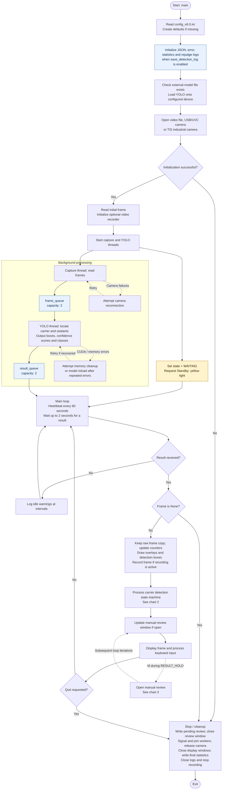
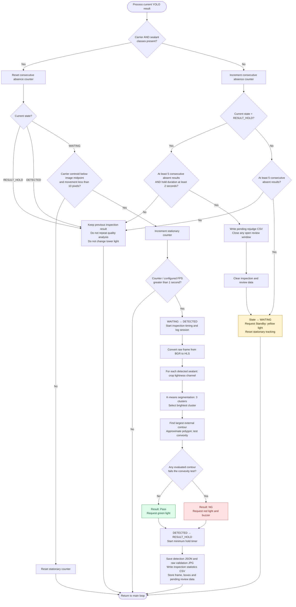
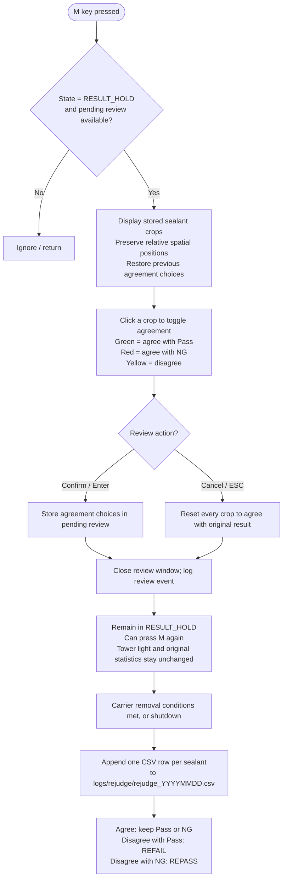
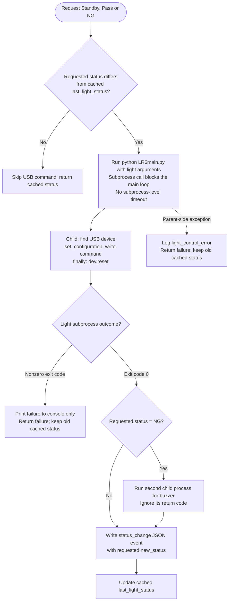

# CutSealant V6.0.7 workflow

Source: [yoloVideoMain_V6.0.7.py](../yoloVideoMain_V6.0.7.py). These Mermaid charts describe the current implementation. View this file in a Markdown viewer that supports Mermaid.

## 1. Application and processing threads

Queue writes have a timeout; a frame or result is dropped when its queue remains full. The main loop keeps waiting when no results arrive, including after video-file exhaustion or a worker stopping; automatic exit on video end is commented out. Unhandled main-loop exceptions and keyboard interruption also lead to cleanup.

## 2. One quality inspection per carrier

Thresholds shown are from the supplied INI: `fps=15`, `stop_threshold_seconds=1`, `distance_threshold_pixels=10`, `absent_tolerance_frames=5`, `result_hold_min_seconds=2`, and `kmeans_clusters=3`. Stationary time is estimated from a processed-result counter divided by configured FPS, rather than measured elapsed time.

YOLO supplies object locations; the separate OpenCV contour test supplies the quality verdict. Despite the helper name `_loop_closed_identify`, its actual final test is `cv2.isContourConvex`. Empty crops, missing contours and caught per-crop errors do not add a failing result, so “Pass” here means no evaluated result failed; it does not guarantee every crop was successfully evaluated.

The chart groups result selection, light requests and entry into `RESULT_HOLD` for readability. In the code, the detection JSON is written first, the state changes to `RESULT_HOLD`, and then the light command and remaining outputs run. The brief `DETECTED` state normally completes within the same main-loop iteration.

## 3. On-demand manual review

Without manual review, all crops default to agreement. If the review window is still open when pending data is written, the program treats it as cancellation and resets all agreement flags to `True`. The CSV also records whether the operator opened review. JSON, statistics CSV and rejudge CSV writers are initialized only when `save_detection_log` is enabled.

## 4. PATLITE tower command and logging path

This path records software commands, with no physical light readback. Child-process USB exceptions/output are not captured into the application log. Command functions returning `False` are ignored by the child entry point, so some write failures can still yield exit code `0`. A cached successful status also prevents resending the same requested state after a physical disconnect. A failed Pass/NG command is not retried continuously in `RESULT_HOLD`; another request must reach `_call_light_once`.

`stop()` does not explicitly send an all-off command to the tower.

## Keyboard controls

| Key | Action |
| --- | --- |
| `q` | Quit |
| `S` / `s` | Save screenshot |
| `P` / `p` | Print and log statistics |
| `r` | Reset processing counters |
| `F` / `f` | Toggle fit-to-screen |
| `G` / `g` | Toggle fullscreen |
| `V` / `v` | Toggle recording |
| `M` / `m` | Open review during `RESULT_HOLD` |
| Enter / ESC | Confirm / cancel in review window |

## Code navigation

| Area | Main methods / classes |
| --- | --- |
| Startup and settings | `main`, `SafeVideoProcessor.initialize`, `ConfigManager` |
| Capture and inference | `_capture_frames`, `_attempt_camera_reconnect`, `_yolo_worker`, `_yolo_detect` |
| Main loop and inspection state | `run`, `_handle_objects_present`, `_handle_objects_absent`, `_check_detection_trigger` |
| Quality analysis | `_cut_sealant_detection`, `_img_kmeans`, `_loop_closed_identify` |
| Human review | `ManualReviewWindow`, `_open_manual_review`, `_handle_review_complete`, `_write_pending_review_log` |
| Tower control | `_call_light_once`, `_call_light`, external `LR6main.py` |
| Logs and reporting | `JSONLogger`, `StatisticsLogger`, `RejudgeLogger`, `_log_heartbeat` |
| Cleanup | `SafeVideoProcessor.stop` |
